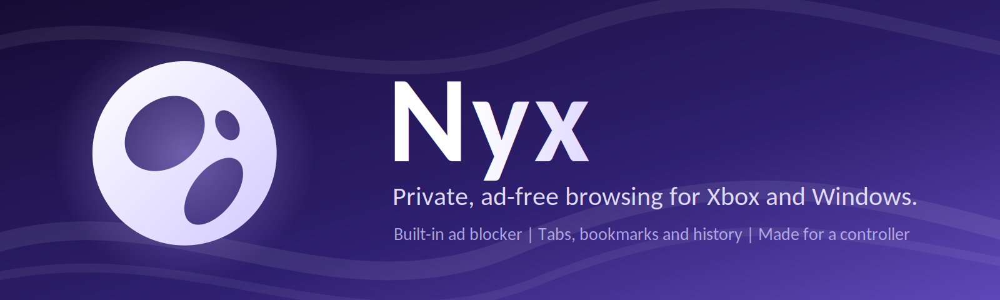
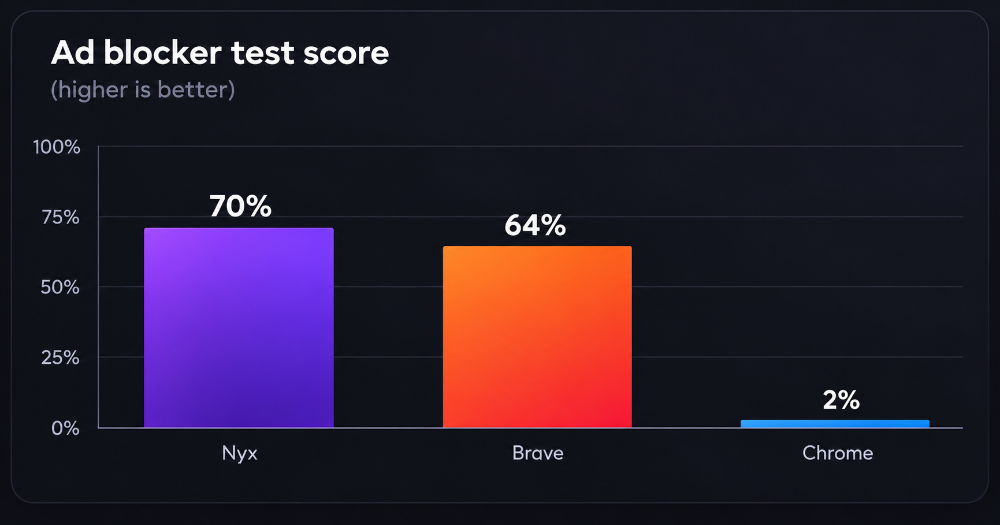
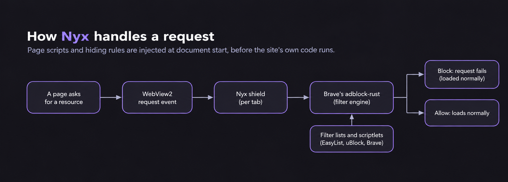

  

  
  
  

Nyx is a lightweight browser for Xbox, with ad and tracker blocking built in. It's made with controller navigation in mind, while still working with a mouse and keyboard.

## Ad-blocking comparison

A side-by-side look at the test results:

  

## How it works

  

Nyx checks requests as pages load, blocks those matched by its ad-blocking rules, and lets the rest through.

## Install

Grab the latest package from [Releases](https://github.com/v7upSln/Nyx-UWP/releases).

**Xbox**

1. Enable Developer Mode on your console.
2. Open the console's Device Portal from a PC.
3. Go to *My games and apps* and install the Nyx package and deps.
4. Launch Nyx from your console.

## Support

Found a bug or have an idea? Drop it in [Issues](https://github.com/v7upSln/Nyx-UWP/issues).

## Credits

Thanks to the projects and contributors whose work helps make Nyx possible. See [NOTICE.md](NOTICE.md) for credits.

Nyx is licensed under the [GNU General Public License v3.0](LICENSE).
